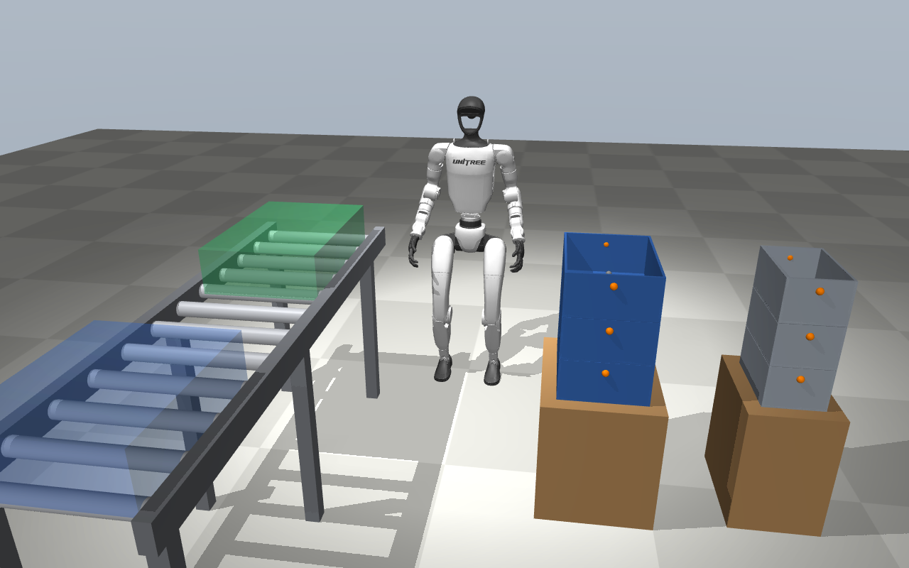
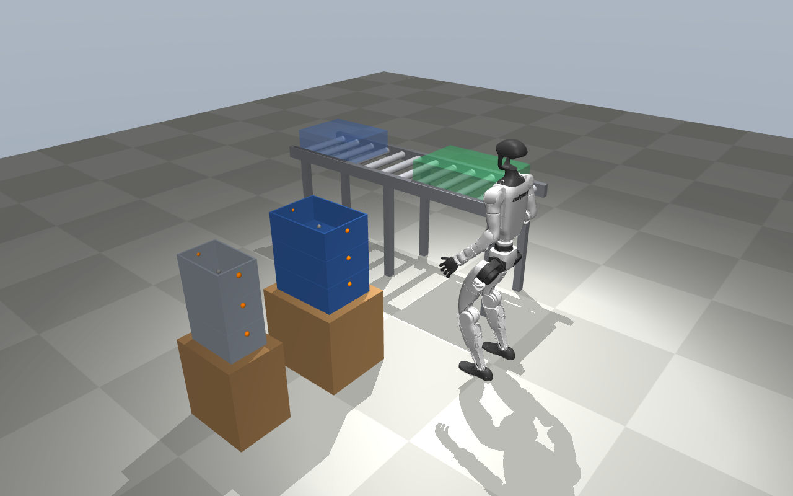

# G1 Tote-Handling Digital Twin

[](https://github.com/velayudhana027/g1-tote-handling-twin/actions/workflows/ci.yml)


A MuJoCo simulation of a humanoid intralogistics task: a **Unitree G1** destacks KLT totes from pallets and
places them on a roller conveyor, where operators take them off.

The task and its KPIs follow the tote-to-conveyor proof of concept that Humanoid ran with its wheeled HMND 01
robot at the Siemens Electronics Factory in Erlangen
([reported January 2026](https://thehumanoid.ai/humanoid-and-siemens-completed-a-proof-of-concept-to-test-humanoidrobots-in-industrial-logistics/)).
This project asks how a **bipedal** humanoid does on the same job, in simulation first, measured the same way.



## Status

Early stage. The cell, the task-success checks and the KPI harness are built and tested; **no controller exists
yet, so the robot does not move and no results are claimed**. Progress is tracked in the
[issues](https://github.com/velayudhana027/g1-tote-handling-twin/issues) and the roadmap below.

## The cell

| Element | Model |
| --- | --- |
| Robot | Unitree G1, 29 DoF, from [unitree-g1-locomotion](https://github.com/velayudhana027/unitree-g1-locomotion) (git submodule); starts in the nominal pose of the trained walking policy, feet on the floor |
| Totes | 3x KLT 4147 (396 x 297 x 147 mm, 0.9 kg) on pallet A and 3x KLT 3147 (297 x 198 x 147 mm, 0.5 kg) on pallet B; free bodies with handle sites on the short sides |
| Conveyor | 1.8 m roller conveyor, bed at about 0.73 m; place zone near the robot, pickup point at the far end |
| Cameras | `overview` and `front` (render with `scripts/render_cell.py`) |



## KPIs

Computed from an event log by [`tote_cell/metrics.py`](tote_cell/metrics.py); success is judged from simulator
state by [`tote_cell/tasks.py`](tote_cell/tasks.py) (tote at rest inside the place zone, tote on the floor,
pelvis below 0.45 m).

| KPI | Definition | Pilot reference (wheeled robot) | This project |
| --- | --- | --- | --- |
| Throughput | totes placed per hour | 60 moves/h | not measured yet |
| Pick-and-place success | placed / pick attempts | above 90 % | not measured yet |
| Continuous autonomous operation | longest stretch without an intervention or a fall | over 30 min | not measured yet |
| Falls | robot falls per run | n/a (wheeled) | not measured yet |

## Roadmap

| # | Step | Status |
| --- | --- | --- |
| 1 | Cell model, task-success checks, KPI harness, CI | ✅ Done |
| 2 | Stand in the cell with the trained policy (needs the sim-to-sim player from unitree-g1-locomotion) | 📋 Next |
| 3 | Walk between pallets and conveyor with velocity commands along waypoints | 📋 Planned |
| 4 | Tote pose from the head camera (fiducial markers on totes) | 📋 Planned |
| 5 | Bimanual grasp and lift: scripted inverse-kinematics baseline | 📋 Planned |
| 6 | Full cycle and 60-minute KPI runs | 📋 Planned |
| 7 | Learned whole-body pick and place (RL or imitation) | 📋 Planned |
| 8 | Robustness: tote mass and position noise, moving conveyor | 📋 Planned |

## Quick start

```bash
git clone --recurse-submodules https://github.com/velayudhana027/g1-tote-handling-twin.git
cd g1-tote-handling-twin
pip install -r requirements.txt

python -m tote_cell.build --view            # open the cell in the MuJoCo viewer
python -m pytest                            # model, task-check and KPI tests
MUJOCO_GL=egl python scripts/render_cell.py # re-render the images in docs/media
```

## Repository structure

```
tote_cell/scene.xml     Fixed cell: floor, pallets, roller conveyor, zones, cameras
tote_cell/build.py      Adds the KLT tote stacks and attaches the G1 (MjSpec); home keyframe
tote_cell/tasks.py      Success checks: tote placed, tote dropped, totes left on stacks, robot fallen
tote_cell/metrics.py    Event log and shift KPIs
scripts/render_cell.py  Headless renders for the README
tests/                  Run by CI on every push
third_party/            unitree-g1-locomotion (robot model and trained policies)
```

## Author

**Velayudhan Aravindakshan**: humanoid robotics, reinforcement learning, simulation.
